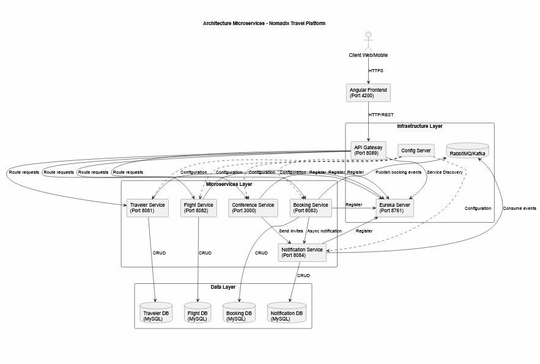

<div align="center">

# 🌍 Nomadix

**Plateforme de réservation de voyages en architecture microservices**  
*Projet final du module Applications Web Distribuées (MT-41) — ESPRIT 2026/2027*

[](https://www.java.com/)
[](https://spring.io/projects/spring-boot/)
[](https://spring.io/projects/spring-cloud)
[](https://angular.io/)
[](https://fastapi.tiangolo.com/)
[](https://nodejs.org/)
[](https://docs.docker.com/compose/)
[](https://www.rabbitmq.com/)
[](https://www.keycloak.org/)
[](https://www.mysql.com/)

</div>

---

## Sommaire

1. [À propos du projet](#1-à-propos-du-projet)
2. [Architecture](#2-architecture)
3. [Stack technique](#3-stack-technique)
4. [Équipe et répartition](#4-équipe-et-répartition)
5. [Détail des microservices](#5-détail-des-microservices)
6. [Sécurité (Keycloak / JWT)](#6-sécurité-keycloak--jwt)
7. [Communication : synchrone et asynchrone](#7-communication--synchrone-et-asynchrone)
8. [Fonctionnalités techniques clés](#8-fonctionnalités-techniques-clés)
9. [Démarrage rapide avec Docker Compose](#9-démarrage-rapide-avec-docker-compose)
10. [Lancement local sans Docker](#10-lancement-local-sans-docker)
11. [Tests et qualité](#11-tests-et-qualité)
12. [Documentation](#12-documentation)
13. [Structure du dépôt](#13-structure-du-dépôt)
14. [Scénarios de démonstration](#14-scénarios-de-démonstration)
15. [Dépannage](#15-dépannage)
16. [Perspectives d'amélioration](#16-perspectives-damélioration)

---

## 1. À propos du projet

**Nomadix** est une plateforme de voyage : un visiteur consulte le catalogue de vols, un
voyageur réserve une place, gère ses vols favoris et reçoit des notifications, tandis
qu'un administrateur pilote le catalogue et les conférences.

L'objectif du module **MT-41** n'était pas de livrer un simple CRUD, mais de relever un
défi d'**architecture distribuée** :

- découper le domaine en services autonomes, déployables et testables séparément ;
- gérer un **stock limité de places** sans surréservation, même sous concurrence ;
- garantir la **cohérence** d'un parcours multi-services (ébauche de *pattern Saga* avec
  compensation si une étape échoue) ;
- éviter les **pannes en cascade** (timeouts, circuit breaker, fallback) ;
- faire communiquer des technologies hétérogènes (**Java**, **Node.js**, **Python**)
  derrière un point d'entrée unique.

Le résultat : **12 conteneurs** orchestrés par Docker Compose, **6 applications**
enregistrées dans Eureka, **3 bases de données** isolées, un bus d'événements RabbitMQ
avec *dead-letter queue*, et une interface Angular complète protégée par Keycloak.

---

## 2. Architecture



Les quatre principes structurants :

- **Database-per-service** — chaque service Java possède sa base (`nomadix_traveler_db`,
  `nomadix_flight_db`, `nomadix_booking_db`). Aucune jointure SQL entre services : les
  liens sont des identifiants logiques (`travelerId`, `flightId`).
- **Service Discovery (Eureka)** — aucune URL n'est codée en dur dans les appelants : la
  Gateway et les clients Feign résolvent `lb://NOM-SERVICE`. Ajouter une instance revient
  à démarrer un conteneur.
- **API Gateway (Spring Cloud Gateway)** — point d'entrée unique (`/api/**`), routage
  dynamique, CORS, validation des JWT. Le navigateur ne connaît qu'une seule origine.
- **Stack polyglotte** — Spring Boot pour le cœur métier, Node/Express pour les
  conférences (léger, orienté I/O), Python/FastAPI pour les notifications et le
  consommateur RabbitMQ.

> Diagrammes détaillés (contexte, conteneurs, workflows, modèle de domaine, saga,
> topologie RabbitMQ) : dossier [`documentation/`](documentation/) et page imprimable
> [`documentation/05-diagrammes.html`](documentation/05-diagrammes.html).

---

## 3. Stack technique

| Couche | Technologie | Usage dans le projet |
| :--- | :--- | :--- |
| Langage / framework | **Java 17 · Spring Boot 3.2.4** | Traveler, Flight, Booking, Gateway, Eureka |
| Microservices | **Spring Cloud 2023.0** (Gateway, OpenFeign, LoadBalancer, Eureka) | Routage, appels inter-services, découverte |
| Résilience | **Resilience4j** (CircuitBreaker, TimeLimiter) | Mode dégradé du Booking-Service |
| Persistance | **MySQL 8.4 · Spring Data JPA / Hibernate** | 3 bases dédiées, `ddl-auto=update` |
| Messagerie | **RabbitMQ 3.13** (exchange topic + DLX/DLQ, `pika`, `spring-amqp`) | Événements métier asynchrones |
| Sécurité | **Keycloak 26.0.8** (OAuth2 / OIDC, JWT, rôles realm) | Authentification, autorisation ADMIN/TRAVELER |
| Frontend | **Angular 18** (standalone components, guards, interceptor JWT) | Interface voyageur et administration |
| Service Node | **Node.js · Express · swagger-ui-express** | Conférences (stockage mémoire) |
| Service Python | **Python 3 · FastAPI · Uvicorn · py-eureka-client** | Notifications + consommateur AMQP |
| Conteneurisation | **Docker · Docker Compose · nginx** | 10 conteneurs, healthchecks, volumes |
| Tests | **JUnit 5 · Mockito · Jest · pytest** | Règles métier, résilience, contrats d'API |
| Documentation | **OpenAPI 3 / Swagger UI · Mermaid** | 5 Swagger + diagrammes versionnés |

---

## 4. Équipe et répartition

Chaque membre est propriétaire de ses services, de son Swagger et de ses tests, ce qui a
permis un développement parallèle sans conflit.

| Membre | Rôle principal | Services et composants |
| :--- | :--- | :--- |
| **Ahmed** (`ahmedsb22`) | Architecture & intégration | API Gateway, Eureka Server, **Booking-Service** (orchestration, Feign, résilience), Docker Compose, CI Git. |
| **Sami** (`samibaazaoui`) | Cœur métier & frontend | **Flight-Service** (catalogue, stock), **Conference-Service** (Node.js), interface **Angular**. |
| **Mohamed Hazem** (`Mohamedhazem.Amor`) | Services support & qualité | **Traveler-Service** (voyageurs, favoris, profilage AOP), **Notification-Service** (Python/FastAPI), tests d'intégration, documentation. |

---

## 5. Détail des microservices

Les ports « local » servent au lancement hors Docker ; les ports « Docker » sont ceux
publiés sur la machine hôte par `docker-compose.yml` (les ports internes des conteneurs
restent 8761 / 8089 / 8081-8084 / 3000).

| Service | Local | Docker | Base de données | Rôle clé | Swagger |
| :--- | :---: | :---: | :--- | :--- | :--- |
| **Eureka Server** | 8761 | [9761](http://localhost:9761) | — | Registre des instances | Dashboard |
| **API Gateway** | 8089 | [9089](http://localhost:9089) | — | Routage `/api/**`, CORS, JWT | [Routes](http://localhost:9089/actuator/gateway/routes) |
| **Traveler-Service** | 8081 | [9081](http://localhost:9081/swagger-ui.html) | `nomadix_traveler_db` | Voyageurs, favoris (Feign), profilage AOP | [Swagger](http://localhost:9081/swagger-ui.html) |
| **Flight-Service** | 8082 | [9082](http://localhost:9082/swagger-ui.html) | `nomadix_flight_db` | Catalogue, stock atomique, `flight.created` | [Swagger](http://localhost:9082/swagger-ui.html) |
| **Booking-Service** | 8083 | [9083](http://localhost:9083/swagger-ui.html) | `nomadix_booking_db` | Saga de réservation, Feign, circuit breaker | [Swagger](http://localhost:9083/swagger-ui.html) |
| **Conference-Service** | 3000 | [3001](http://localhost:3001/swagger-ui) | mémoire | CRUD conférences et sessions | [Swagger](http://localhost:3001/swagger-ui) |
| **Notification-Service** | 8084 | [9084](http://localhost:9084/swagger-ui) | mémoire + volume `notifications.json` | Notifications, consommateur RabbitMQ | [Swagger](http://localhost:9084/swagger-ui) |
| **Frontend Angular** | 4200 | [8090](http://localhost:8090) | — | Interface voyageur / admin | — |
| **Keycloak** | 8180 | [8180](http://localhost:8180) | H2 embarqué | Identité, JWT, rôles | Console admin |
| **RabbitMQ** | 5672 / 15672 | 5672 / [15672](http://localhost:15672) | volume | Bus d'événements, console de gestion | — |

Fonctionnellement, l'interface Angular couvre cinq écrans : **Vols** (catalogue public,
recherche, création ADMIN), **Voyageurs** (CRUD, favoris, profil calculé), **Réservations**
(réserver / annuler avec restitution du stock), **Conférences** et **Notifications**
(envoi + événements RabbitMQ consommés).

---

## 6. Sécurité (Keycloak / JWT)

Keycloak est le **seul émetteur de jetons** (realm `nomadix`). La Gateway vérifie la
signature (JWKS), l'émetteur (`iss`) et l'audience (`aud = nomadix-api`), puis relaie
l'en-tête `Authorization`. Chaque microservice Java **revalide** le jeton et les rôles :
la Gateway n'est jamais le seul rempart (*défense en profondeur*).

| Client Keycloak | Type de flux | Usage |
| :--- | :--- | :--- |
| `nomadix-frontend` | Authorization Code + PKCE | Application Angular |
| `nomadix-swagger` | Authorization Code + PKCE | Bouton **Authorize** des Swagger |
| `nomadix-cli` | Resource Owner Password | Scripts `curl` de démonstration |

| Rôle | Droits | Compte de test |
| :--- | :--- | :--- |
| `ADMIN` | Écriture du catalogue et des conférences, suppression de voyageur, profilage, émission d'événements | `admin` / `admin123` |
| `TRAVELER` | Lecture, réservations, favoris, notifications | `sami` / `sami123` |
| anonyme | `GET /api/flights`, `GET /api/conferences` | — |

Une écriture sans rôle `ADMIN` renvoie **403** (et non 401) : le jeton est valide, mais le
droit manque. C'est un point explicitement vérifié dans les scénarios de test.

---

## 7. Communication : synchrone et asynchrone

Le projet illustre volontairement **deux canaux**, avec un critère de choix assumé.

| Canal | Technologie | Quand l'utiliser | Exemples |
| :--- | :--- | :--- | :--- |
| **Synchrone** | OpenFeign + Eureka + Resilience4j | la réponse est **nécessaire pour continuer** | Booking lit le prix et réserve une place ; Traveler enrichit un favori |
| **Asynchrone** | RabbitMQ topic `nomadix.events` | l'action ne doit **pas attendre** et peut être rejouée | `flight.created`, `traveler.registered`, `booking.created`, `booking.cancelled` |

### Topologie RabbitMQ

```
producteurs (Flight, Traveler, Booking)
        │  routing keys flight.# / traveler.# / booking.#
        ▼
exchange topic  nomadix.events
        ▼
file durable    notification.events  ──►  consommateur Python (pika)
        │  basic_nack(requeue=false)
        ▼
exchange        nomadix.dlx
        ▼
file            notification.events.dlq   (en-tête x-death)
```

- **Durable** : les messages survivent à l'arrêt du consommateur ; ils sont traités au
  redémarrage, sans doublon (les messages déjà `ack` ne sont pas rejoués).
- **Dead-lettering** : un message invalide ou marqué `simulateFailure` est refusé, routé
  vers `nomadix.dlx` puis `notification.events.dlq` — visible dans la console de gestion.
- **Mode dégradé** : la publication est *fire-and-forget*. Broker éteint, la réservation
  aboutit quand même (`201`) et l'endpoint de test renvoie `published: false`.

### Appels OpenFeign

| Appelant → appelé | Endpoint Feign | Preuve observable |
| :--- | :--- | :--- |
| Booking → Traveler | `GET /api/travelers/{id}` | Réservation refusée si le voyageur n'existe pas |
| Booking → Flight | `GET /api/flights/{id}` + `POST /{id}/seats/reserve` | Prix lu, stock décrémenté, `409` si épuisé |
| Traveler → Flight | `GET /api/flights/{id}` | Favoris enrichis (villes, date, prix) |

Chaque client possède un **fallback** (`FlightClientFallbackFactory`,
`TravelerClientFallbackFactory`) et un circuit breaker configuré (timeouts 2 s / 3 s,
TimeLimiter 4 s). La panne d'un service produit une réponse dégradée explicite, jamais un
thread bloqué.

---

## 8. Fonctionnalités techniques clés

| Mécanisme | Implémentation | Bénéfice |
| :--- | :--- | :--- |
| **Saga de réservation** | `BookingService` : lecture voyageur → lecture vol → réservation de place → écriture locale | Parcours multi-services cohérent |
| **Compensation** | si l'écriture locale échoue, appel `release` au Flight-Service | Pas de réservation fantôme |
| **Pas de surréservation** | `UPDATE ... WHERE available_seats > 0` atomique en base | Stock fiable sous concurrence |
| **Idempotence d'annulation** | annulation rejouable, stock restitué une seule fois | Pas de double crédit |
| **Circuit breaker + fallback** | Resilience4j sur les deux clients Feign | Pas de panne en cascade |
| **Smart Profiling** | aspect AOP + moteur de règles (`ProfilingRulesEngine`) | Score et segment voyageur calculés automatiquement |
| **Dead-letter queue** | `x-dead-letter-exchange` + `basic_nack(requeue=false)` | Messages en échec traçables et rejouables |
| **Défense en profondeur** | JWT validé à la Gateway **et** dans chaque service Java | Un contournement de la Gateway ne suffit pas |
| **Documentation vivante** | 5 Swagger + diagrammes Mermaid versionnés | Le rapport reste aligné sur le code |

---

## 9. Démarrage rapide avec Docker Compose

### Prérequis

- **Docker Desktop** (avec WSL2 sous Windows), 4 Go de RAM alloués au moteur ;
- ports libres : `8090`, `9081-9084`, `9089`, `9761`, `8180`, `15672`, `3307`, `3001`.

### Commandes

```bash
docker compose up -d --build      # premier lancement : compilation de 8 images
docker compose ps                 # tous les conteneurs doivent être "Up" / "healthy"
docker compose logs -f booking-service notification-consumer
```

Ordre de démarrage géré par les `healthcheck` / `depends_on` : MySQL, RabbitMQ, Eureka et
Keycloak sont attendus sains avant les services métier.

### Accès

| Composant | URL | Identifiants |
| :--- | :--- | :--- |
| **Interface Angular** | <http://localhost:8090> | `admin` / `admin123` · `sami` / `sami123` |
| API Gateway | <http://localhost:9089> | — |
| Eureka | <http://localhost:9761> | — |
| Swagger Traveler / Flight / Booking | <http://localhost:9081> · <http://localhost:9082> · <http://localhost:9083> (`/swagger-ui.html`) | bouton **Authorize** |
| Swagger Notification / Conference | <http://localhost:9084/swagger-ui> · <http://localhost:3001/swagger-ui> | bouton **Authorize** |
| Keycloak | <http://localhost:8180> | `admin` / `admin` |
| RabbitMQ management | <http://localhost:15672> | `nomadix` / `nomadix123` |
| MySQL | `localhost:3307` | `root` / `root` (admin) · `nomadix` / `nomadix123` (applicatif) |

Le frontend est servi par **nginx** : `/api/**` est proxifié vers la Gateway. Le navigateur
n'a donc qu'une seule origine (`http://localhost:8090`), et aucun appel direct à un
microservice n'est nécessaire.

### Cycle de vie

```bash
docker compose stop                    # arrêt sans perte de données
docker compose down                    # suppression des conteneurs (volumes conservés)
docker compose down -v                 # reset complet : MySQL et RabbitMQ vidés
docker compose up -d --build <service> # reconstruction ciblée
```

Volumes persistants : `nomadix-mysql-data`, `nomadix-rabbitmq-data`,
`nomadix-notifications` (archive des événements consommés).

---

## 10. Lancement local sans Docker

Utile pour déboguer un service dans l'IDE. Prérequis : **JDK 17 + Maven**, **Node.js 18/20**,
**Python 3.10+**, **MySQL** (XAMPP, port `3306`, `root` sans mot de passe), **RabbitMQ** et
**Keycloak** démarrés séparément.

```bash
# A. Registre (à démarrer en premier)
cd backend/discovery/eureka-server && mvn spring-boot:run

# B. Gateway
cd backend/gateway && mvn spring-boot:run

# C. Microservices Java
cd backend/microservices/traveler-service && mvn spring-boot:run
cd backend/microservices/flight-service   && mvn spring-boot:run
cd backend/microservices/booking-service  && mvn spring-boot:run

# D. Service Node.js (conférences)
cd backend/microservices/conference-service && npm install && npm start

# E. Service Python (notifications) + consommateur
cd backend/microservices/notification
py -m pip install -r requirements.txt
py -m uvicorn app.main:app --reload --port 8084
py packh_rabbit_consumer.py

# F. Frontend
cd frontEnd/NomadixWeb && npm install && npm start
```

Aucun script SQL n'est nécessaire : chaque service crée sa base au premier démarrage
(`createDatabaseIfNotExist=true`) et Hibernate génère les tables (`ddl-auto=update`).
Le proxy Angular (`proxy.conf.json`) envoie **toutes** les requêtes `/api/**` vers la
Gateway (`http://localhost:8089`).

---

## 11. Tests et qualité

| Périmètre | Commande | Ce qui est vérifié |
| :--- | :--- | :--- |
| Gateway | `cd backend/gateway && mvn test` | Configuration CORS (origines autorisées, préflight) |
| Booking | `cd backend/microservices/booking-service && mvn test` | Saga nominale, compensation, fallback, publication d'événements |
| Traveler | `cd backend/microservices/traveler-service && mvn test` | Moteur de profilage, calcul des scores et segments |
| Notification | `cd backend/microservices/notification && py -m pip install -r requirements-dev.txt && py -m pytest` | Contrat de l'API et routes exposées |
| Conference | `cd backend/microservices/conference-service && npm test` | Santé du service et contrat OpenAPI |
| Frontend | `cd frontEnd/NomadixWeb && npm run build` | Compilation stricte TypeScript / Angular |

Les tests de contrat vérifient que la spécification OpenAPI publiée contient bien les
routes réellement servies : la documentation ne peut pas dériver silencieusement.
Les scénarios de bout en bout (Eureka, Gateway, OpenFeign, RabbitMQ) sont décrits dans
[`documentation/06-scenarios-test.md`](documentation/06-scenarios-test.md).

---

## 12. Documentation

Toute la documentation technique est versionnée dans le dépôt.

| Fichier | Contenu |
| :--- | :--- |
| [`documentation/01-architecture.md`](documentation/01-architecture.md) | Contexte, conteneurs, ports, Gateway, CORS, sécurité, déploiement — 5 diagrammes |
| [`documentation/02-workflows.md`](documentation/02-workflows.md) | Workflows de bout en bout : CRUD, saga, compensation, circuit breaker, favoris, profilage, RabbitMQ — 12 diagrammes |
| [`documentation/03-domain-model.md`](documentation/03-domain-model.md) | Modèle de domaine, DTO, schémas de bases, règles de scoring — 4 diagrammes |
| [`documentation/04-api-reference.md`](documentation/04-api-reference.md) | Catalogue des endpoints, matrice de droits, codes de retour |
| [`documentation/05-diagrammes.html`](documentation/05-diagrammes.html) | Planche imprimable (SVG autonome, aucun CDN) |
| [`documentation/06-scenarios-test.md`](documentation/06-scenarios-test.md) | Scénarios OpenFeign et RabbitMQ, commandes `curl`, dépannage |
| [`documentation/README.md`](documentation/README.md) | Index du dossier et conventions de maintenance |

Les diagrammes sont écrits en **Mermaid** : ils se rendent directement sur GitHub, dans
VS Code (*Markdown Preview Mermaid Support*) ou via `npx @mermaid-js/mermaid-cli`.
Chaque service expose par ailleurs son **Swagger UI** avec le bouton *Authorize*
(Keycloak) et, pour le Booking-Service, les scénarios de démonstration documentés dans
la description de l'API.

---

## 13. Structure du dépôt

```
Nomadix/
├── backend/
│   ├── discovery/eureka-server/          # registre de services (8761)
│   ├── gateway/                          # Spring Cloud Gateway + sécurité (8089)
│   ├── microservices/
│   │   ├── traveler-service/             # Java / JPA / Feign / AOP (8081)
│   │   ├── flight-service/               # Java / JPA / AMQP (8082)
│   │   ├── booking-service/              # Java / Feign / Resilience4j (8083)
│   │   ├── conference-service/           # Node.js / Express (3000)
│   │   └── notification/                 # Python / FastAPI + consommateur (8084)
│   ├── keycloak/nomadix-realm.json       # realm, clients, rôles, utilisateurs
│   └── messaging/rabbitmq/               # rabbitmq.conf + definitions.json (topologie)
├── frontEnd/NomadixWeb/                  # Angular 18 + nginx (Dockerfile, proxy)
├── documentation/                         # diagrammes Mermaid, rapports, scénarios
├── docker/mysql/init/01-databases.sql    # 3 bases + compte applicatif
├── docker-compose.yml                    # orchestration des 12 conteneurs
└── README.md
```

---

## 14. Scénarios de démonstration

Le guide complet (commandes, résultats attendus, mode dégradé) est dans
[`documentation/06-scenarios-test.md`](documentation/06-scenarios-test.md). Résumé :

| # | Scénario | Point de preuve |
| :--- | :--- | :--- |
| F1 | Favoris d'un voyageur (Feign Traveler → Flight) | Champs du vol affichés alors que Traveler ne stocke que `flightId` |
| F2 | Diagnostic des deux clients Feign | `GET /api/bookings/integrations/feign` → `reachable` / `found` |
| F3 | Saga de réservation nominale | Stock −1, réservation `CONFIRMED`, `booking.created` archivé |
| F4 | Stock épuisé | `409`, aucun surbooking |
| F5 | Panne du Flight-Service | Fallback, circuit `OPEN` puis `HALF_OPEN`, aucun thread bloqué |
| F6 | Voyageur inexistant | `404` propagé, aucune réservation orpheline |
| R1-R4 | `traveler.registered`, `flight.created`, `booking.created`, `booking.cancelled` | File `notification.events` vidée, événements archivés |
| R5 | Message empoisonné | `x-death` (`reason=rejected`) dans `notification.events.dlq` |
| R6 | `simulateFailure` | `basic_nack(requeue=false)` → DLQ, sans boucle |
| R7 | RabbitMQ arrêté | Réservation `201`, publication `published: false` |
| R8 | Redémarrage du consommateur | Messages durables traités, aucun doublon |

**Console RabbitMQ** (<http://localhost:15672>) : onglet **Queues** pour suivre *Ready /
Unacked / Consumers*, onglet **Exchanges** pour visualiser `nomadix.events` et
`nomadix.dlx`, et *Get messages* sur la DLQ pour lire l'en-tête `x-death`.

---

## 15. Dépannage

| Symptôme | Cause probable | Action |
| :--- | :--- | :--- |
| `503` sur toutes les routes | aucune instance dans Eureka | vérifier <http://localhost:9761>, `docker restart nomadix-<service>` |
| `401` avec un jeton valide | audience `nomadix-api` absente | utiliser les clients `nomadix-cli` / `nomadix-swagger` |
| `403` sur une écriture | compte sans rôle `ADMIN` | se connecter avec `admin` |
| `TypeError: NetworkError` dans Swagger | préflight CORS refusé | rester sur `localhost` (pas `127.0.0.1`) |
| Consommateur en boucle `PRECONDITION_FAILED` | file existante sans arguments DLX | supprimer `notification.events` dans l'UI RabbitMQ, relancer |
| Eureka affiche une IP `172.20.x.x` | hostname d'instance mal configuré | vérifier `EUREKA_INSTANCE_*` du service |
| Frontend `502` sur `/api/**` | Gateway non démarrée | `docker compose logs gateway` |

---

## 16. Perspectives d'amélioration

- **Observabilité** : tracing distribué (OpenTelemetry + Zipkin) et métriques Micrometer
  agrégées, aujourd'hui limitées à Actuator service par service.
- **Saga persistée** : remplacer l'orchestration en mémoire par un état de saga persisté
  (ou un broker de workflow) pour survivre à un redémarrage en cours de compensation.
- **Sécurité de bout en bout** : valider le JWT également dans les services Node et
  Python, et fermer l'accès direct à leurs ports.
- **Persistance** : remplacer le stockage mémoire des conférences et des notifications par
  une base dédiée.
- **CI/CD** : pipeline GitHub Actions (build, tests, publication des images) et
  déploiement Kubernetes.
- **Pagination et filtrage** : sur les listes de réservations et de notifications.

---

<div align="center">

**Nomadix** — projet MT-41, ESPRIT 2026/2027  
Documentation technique : [`documentation/`](documentation/) · Scénarios : [`documentation/06-scenarios-test.md`](documentation/06-scenarios-test.md)

</div>
