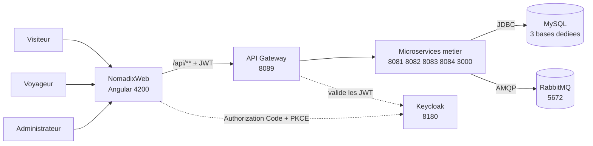
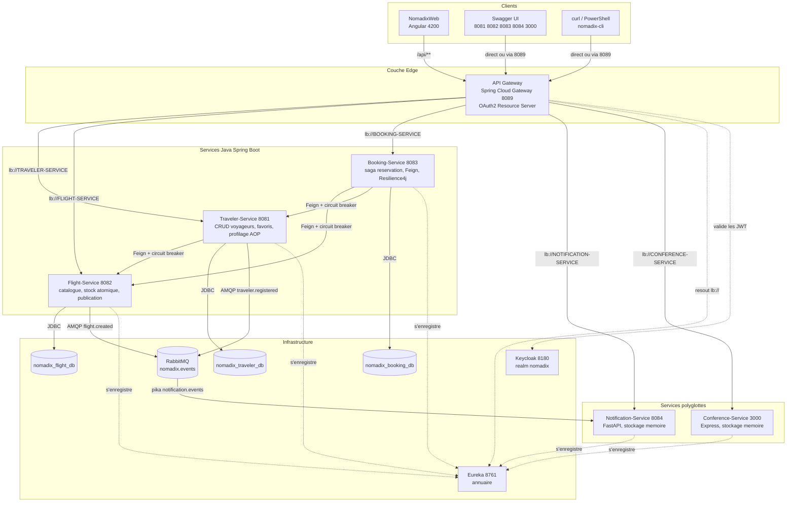
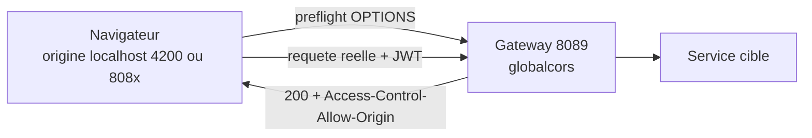
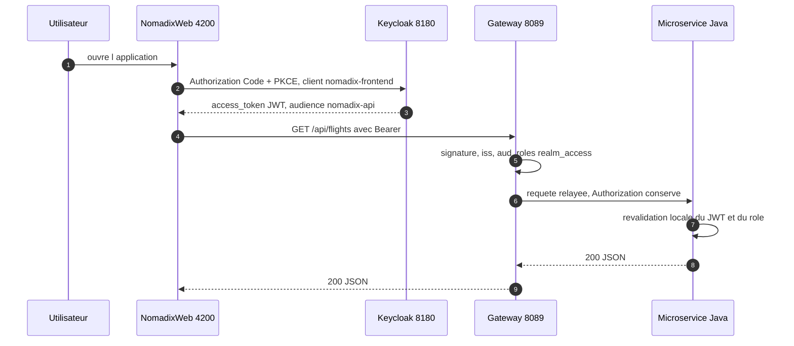
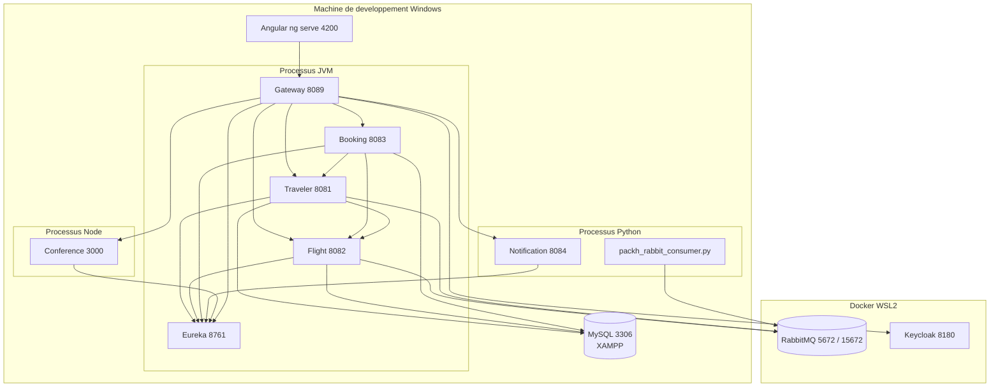

# 01 - Architecture

Vue structurelle de Nomadix : qui parle a qui, sur quel port, avec quel moyen de transport
et quelle protection. Le detail des flux est dans [02-workflows.md](02-workflows.md).

## 1. Contexte du systeme

Nomadix est une plateforme de voyage : un visiteur consulte le catalogue de vols, un
voyageur reserve une place, suit ses favoris et recoit des notifications ; un
administrateur gere le catalogue et les conferences. L'identite est deleguee a Keycloak.

## 2. Conteneurs (vue de deploiement logique)

Chaque service est un processus independant, avec son propre port et, pour les services
Java, sa propre base. Aucun service ne lit la base d'un autre.

## 3. Ports, persistance, responsabilites

| Composant | Port | Technologie | Persistance | Responsabilite |
|---|---:|---|---|---|
| Eureka Server | 8761 | Spring Boot | - | annuaire des instances |
| API Gateway | 8089 | Spring Cloud Gateway (WebFlux) | - | entree unique `/api/**`, CORS, validation JWT, load balancing |
| Traveler-Service | 8081 | Spring Boot 3.2.4 / JPA | MySQL `nomadix_traveler_db` | voyageurs, favoris, profils calcules |
| Flight-Service | 8082 | Spring Boot 3.2.4 / JPA / AMQP | MySQL `nomadix_flight_db` | catalogue, stock de places, evenements |
| Booking-Service | 8083 | Spring Boot 3.2.4 / Feign / Resilience4j | MySQL `nomadix_booking_db` | orchestration des reservations |
| Notification-Service | 8084 | Python / FastAPI | memoire + `notifications.json` | notifications, consommateur AMQP |
| Conference-Service | 3000 | Node.js / Express | memoire (2 conferences de depart) | CRUD conferences |
| Keycloak | 8180 | Keycloak 26.0.8 | H2 embarque | identite, JWT, roles |
| RabbitMQ | 5672 / 15672 | rabbitmq:3-management | disque du conteneur | bus d'evenements `nomadix.events` |
| NomadixWeb | 4200 | Angular 18 | - | interface utilisateur |

## 4. Deux canaux de communication, un critere de choix

| Canal | Technologie | Quand l'utiliser | Exemples dans Nomadix |
|---|---|---|---|
| Synchrone | OpenFeign + Eureka + Resilience4j | la reponse est **necessaire pour continuer** | Booking lit le prix et reserve une place ; Traveler verifie et enrichit un favori |
| Asynchrone | RabbitMQ topic `nomadix.events` | l'action ne doit **pas attendre** et peut etre rejouee | `flight.created`, `traveler.registered` consommes par le service de notification |

Regle appliquee : une operation qui doit echouer si la dependance est absente reste
synchrone ; une operation de diffusion (notifier, rafraichir un cache) part en asynchrone.

## 5. La Gateway en detail

### 5.1 Routes explicites

| Route | Prefixe | Cible | Droits appliques par la Gateway |
|---|---|---|---|
| `traveler-service` | `/api/travelers/**` | `lb://TRAVELER-SERVICE` | authentifie ; `DELETE` et `/profiles/**` = ADMIN |
| `flight-service` | `/api/flights/**` | `lb://FLIGHT-SERVICE` | `GET` public ; ecritures = ADMIN |
| `booking-service` | `/api/bookings/**` | `lb://BOOKING-SERVICE` | authentifie |
| `notification-service` | `/api/notifications/**` | `lb://NOTIFICATION-SERVICE` | authentifie |
| `conference-service` | `/api/conferences/**` | `lb://CONFERENCE-SERVICE` | `GET` public ; ecritures = ADMIN |
| `packh-*` | `/api/packh/**` | `lb://TRAVELER-SERVICE`, `lb://FLIGHT-SERVICE`, `lb://BOOKING-SERVICE` | ADMIN (regle `/api/packh/**`) ; un prefixe par service proprietaire de ses evenements |

Deux consequences a connaitre :

1. **`discovery.locator.enabled=true`** cree automatiquement des routes
   `/SERVICE-ID/**` (minuscules) vers chaque instance Eureka. Ces routes ne portent pas les
   regles fines de `/api/**` ; la protection reelle reste celle du microservice, qui
   revalide le JWT et ses roles (defense en profondeur). Pour un environnement de
   production, desactiver le locator et ne garder que les routes explicites.
2. Les endpoints d'emission RabbitMQ (`/api/packh/traveler-events`, `/api/packh/flight-events`,
   `/api/packh/booking-events`, `/api/packh/rabbitmq/**`) sont routes par la Gateway vers le
   service proprietaire (ADMIN requis). Ils restent joignables en direct sur 8081 / 8082 /
   8083 pour le debogage, sans passer par l'equilibrage de charge.

### 5.2 CORS

Une seule origine etait autorisee (`http://localhost:4200`), alors que les specs OpenAPI
proposent `http://localhost:8089` comme serveur : depuis un Swagger UI servi sur 8081, le
bouton *Try it out* etait bloque par le navigateur. Les origines des Swagger UI
(`3000`, `8081` a `8084`, `8089`) sont desormais autorisees dans
`backend/gateway/src/main/resources/application.yml`. L'origine Angular reste la seule
utilisee en production.

## 6. Chaine de securite

Keycloak est le seul emetteur de jetons. La Gateway verifie la signature (JWKS), l'emetteur
(`iss`) et l'audience (`aud = nomadix-api`), puis relaie l'en-tete `Authorization` intact.
Chaque microservice Java revalide le meme jeton : la Gateway n'est jamais le seul rempart.

| Role | Portee | Comptes de test |
|---|---|---|
| `ADMIN` | ecriture du catalogue et des conferences, suppression de voyageur, profilage, emission d'evenements | `admin` / `admin123` (ADMIN + TRAVELER) |
| `TRAVELER` | lecture, reservations, favoris, notifications | `sami` / `sami123` |
| anonyme | lecture du catalogue (`GET /api/flights`, `GET /api/conferences`) | - |

Note : les services Node et Python ne valident pas le JWT eux-memes. La securite y est
portee par la Gateway (modele *edge*), et l'acces direct aux ports 3000 / 8084 reste
ouvert sur la machine de developpement. C'est un ecart assume, documente dans
[04-api-reference.md](04-api-reference.md).

## 7. Deploiement local

## 8. Ce que cette architecture garantit, et ce qu'elle ne garantit pas

| Garantie | Mecanisme |
|---|---|
| Pas de couplage par les donnees | une base par service, liens par identifiants logiques |
| Pas de point d'entree multiple | Gateway unique pour le frontend |
| Pas de panne en cascade cote Booking | timeouts 2 s / 3 s, circuit breaker, fallback |
| Pas de surreservation | `UPDATE ... WHERE available_seats > 0` atomique |
| Pas de reservation fantome | compensation `release` si l'ecriture locale echoue |
| Traçabilite des acces | JWT valide a la Gateway **et** dans chaque service Java |

| Limite assumee | Consequence |
|---|---|
| Notification et Conference ne valident pas le JWT | a ne pas exposer hors du poste de dev |
| Resumes non filtres par proprietaire | `GET /api/bookings` renvoie toutes les reservations |
| Aucun evenement emis a la creation d'une reservation | la notification de reservation reste manuelle (voir [02-workflows.md](02-workflows.md)) |
| Stockage memoire cote Node/Python | perte des donnees au redemarrage |
| Pas de tracing distribue | diagnostic par metriques Actuator service par service |

Le verdict detaille (forces, faiblesses, priorites) est en fin de [`../update2.md`](../update2.md).
