# 02 - Workflows

Huit workflows, chacun avec son diagramme et les fichiers de code qui le portent.
Les statuts HTTP indiques sont ceux du code actuel, pas ceux du sujet.

## W1 - CRUD isole : creer un voyageur

Un service qui gere sa propre base sans appeler personne. Aucun `@FeignClient`, aucun
`RabbitTemplate` dans le chemin : c'est le scenario « communication isolee ».

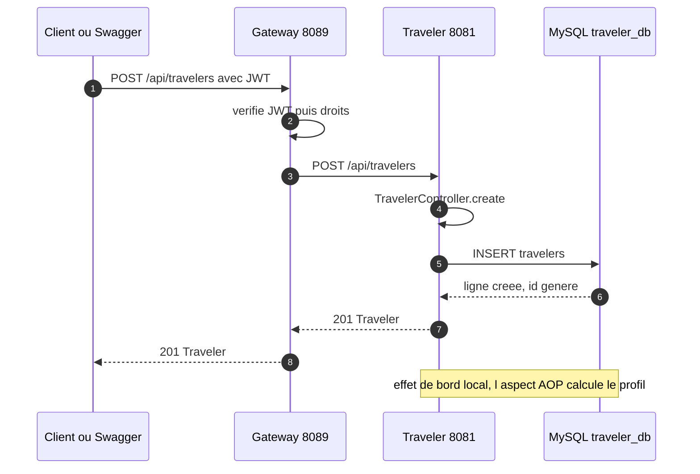

Code : `traveler/controller/TravelerController.java`, `traveler/repository/TravelerRepository.java`.
Les favoris passent par un second controleur (`FavoriteFlightController`) et, eux, appellent
Flight (W5).

## W2 - Saga de reservation nominale

`POST /api/bookings?travelerId=X&flightId=Y`. Le Booking-Service orchestre deux appels
synchrones avant d'ecrire chez lui. Le prix affiche dans la reservation est la preuve que
Feign a bien lu le vol.

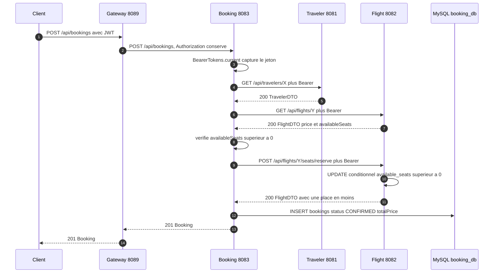

Points a retenir :

- le jeton est capture **avant** l'appel Feign : le circuit breaker execute l'appel dans un
  `CompletableFuture`, ou le `SecurityContext` n'existe plus (`security/BearerTokens.java`) ;
- le stock est decremente par une requete atomique
  (`FlightRepository.decrementSeat`), pas par un lire-puis-ecrire ;
- la reservation nait directement `CONFIRMED` (`BookingService.createBooking`).

## W3 - Compensation si l'ecriture locale echoue

Pas de transaction distribuee : si la sauvegarde de la reservation echoue apres le
decrement, Booking rend la place (compensation best-effort).

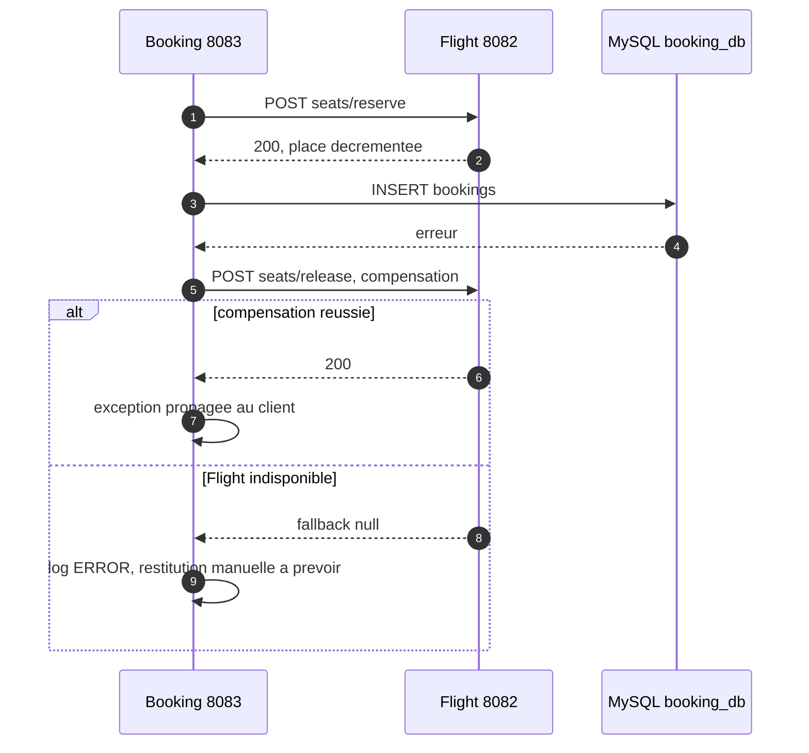

## W4 - Panne de Flight : circuit breaker et fallback

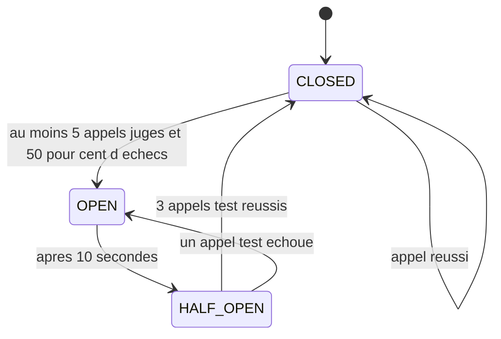

Configuration reelle (`booking-service/src/main/resources/application.properties`) :

| Parametre | Valeur | Effet |
|---|---|---|
| `connect-timeout` | 2 000 ms | une instance morte est detectee vite |
| `read-timeout` | 3 000 ms | au lieu des 60 s par defaut de Feign |
| `timelimiter ... timeout-duration` | 4 s | doit rester superieur au read-timeout |
| `sliding-window-size` | 10 | fenetre d'observation |
| `minimum-number-of-calls` | 5 | pas de jugement sur 1 ou 2 appels |
| `failure-rate-threshold` | 50 % | seuil d'ouverture |
| `wait-duration-in-open-state` | 10 s | duree avant test |
| `permitted-number-of-calls-in-half-open-state` | 3 | appels de verification |
| `register-health-indicator` | true | etat visible dans `/actuator/health` |

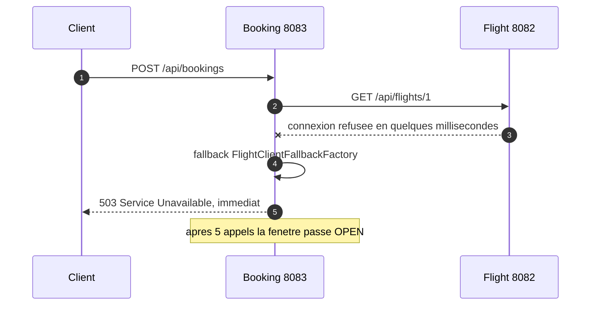

Le nom du circuit breaker n'est pas `client_methode` : `CircuitBreakerNameResolverConfig`
force le nom court du client Feign. D'ou deux prefixes de configuration differents :

| Service | `@FeignClient(name=...)` | Prefixe de configuration |
|---|---|---|
| Booking | `flight-service` | `...config.flight-service.*` |
| Traveler | `FLIGHT-SERVICE` | `...config.[FLIGHT-SERVICE].*` (crochets = casse preservee) |

Comportement des fallbacks :

| Client | Erreur propagee | Sinon |
|---|---|---|
| Booking vers Flight, `getFlightById` | 404 tel quel | 503 |
| Booking vers Flight, `reserveSeat` | 404 et 409 tels quels | 503 |
| Booking vers Flight, `releaseSeat` | - | `null` + log ERROR |
| Booking vers Traveler | 404 tel quel | `null`, converti en 503 |
| Traveler vers Flight | - | `null` (favori) ou liste vide |

## W5 - Favoris : enrichissement synchrone Traveler vers Flight

Seuls les identifiants sont stockes (`@ElementCollection Set<Long>`). Le detail est lu a
chaque affichage : pas de copie de donnees entre services.

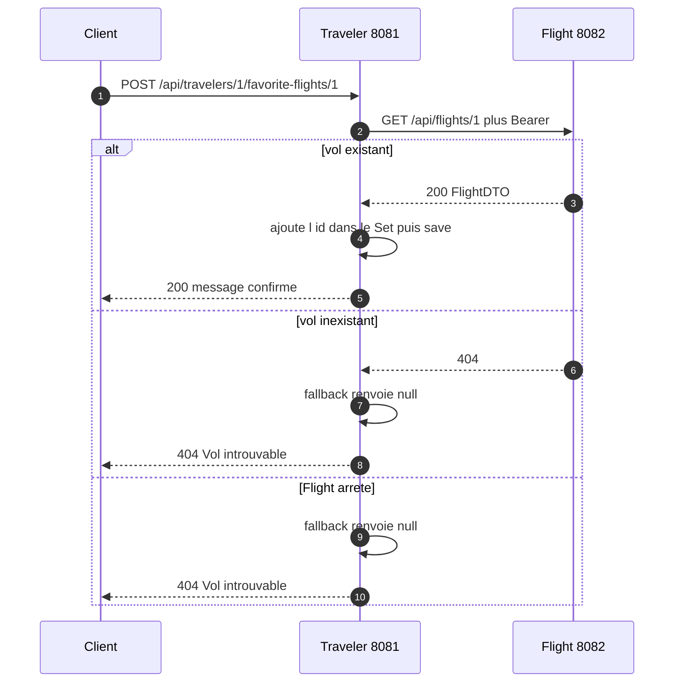

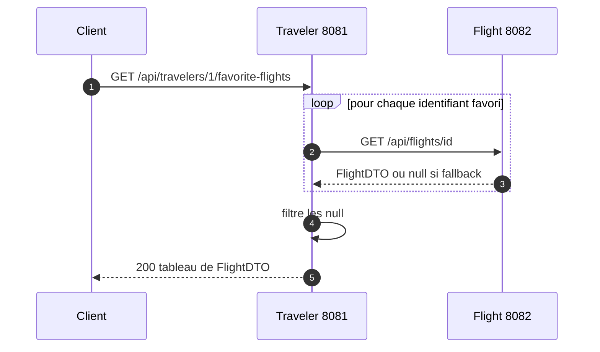

`GET` renvoie des vols complets (`departureCity`, `arrivalCity`, `price`), jamais
`[null]` : le filtre a ete ajoute pour respecter le schema publie.

## W6 - Profilage automatique par AOP

Aucune ligne du CRUD n'a ete modifiee : un aspect intercepte les sauvegardes du repository.

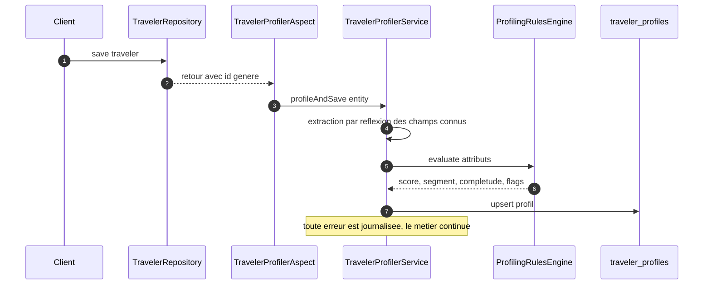

Une suppression de voyageur declenche la suppression du profil. L'aspect exclut
`TravelerProfile` pour eviter la recursion.

## W7 - RabbitMQ : publication et consommation

Topologie reelle, declaree par le service Python et par les configurations Java :

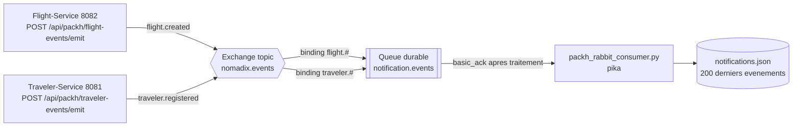

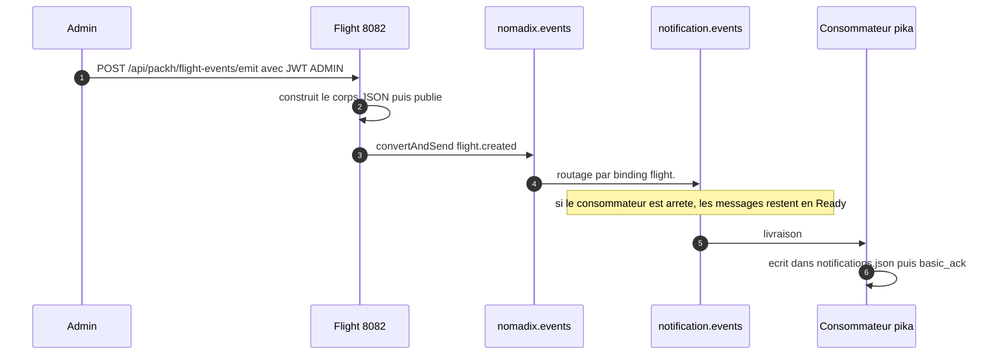

- `GET /api/notifications` (FastAPI, memoire) **n'expose pas** ces evenements : ils vont
  dans `notifications.json`, lu par le consommateur. Deux stockages, deux usages.
- Aucun evenement n'est emis automatiquement par un CRUD : publier passe par les endpoints
  `/api/packh/...`, qui sont des declencheurs de demonstration.
- Booking ne publie rien : il n'a pas la dependance AMQP (voir la limite en fin de
  [`../update2.md`](../update2.md)).

## W8 - Cycle de vie d'une reservation

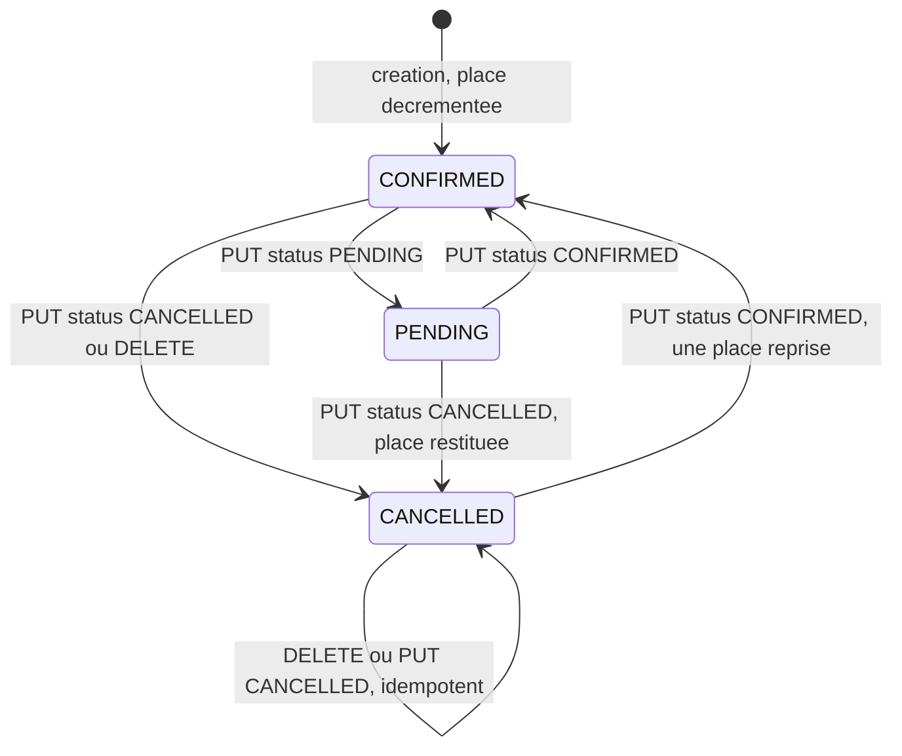

Regles verifiees dans `BookingService` :

| Action | Effet sur le stock | Idempotence |
|---|---|---|
| creation | -1, refus 409 si complet | non |
| `PUT ...?status=CANCELLED` | +1 | oui si deja annulee |
| `DELETE /api/bookings/{id}` | +1 | oui, ne rend jamais deux places |
| `PUT ...?status=CONFIRMED` depuis `CANCELLED` | -1, 409 si complet | non |
| `PUT` avec un statut inconnu | aucun | 400 |

Le statut par defaut `PENDING` n'est applique que s'il est absent
(`Booking.onCreate`), ce qui preserve `CONFIRMED` pose par le service.

## Ordre de demarrage

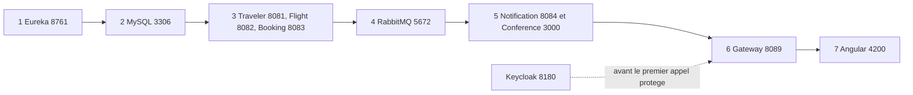
