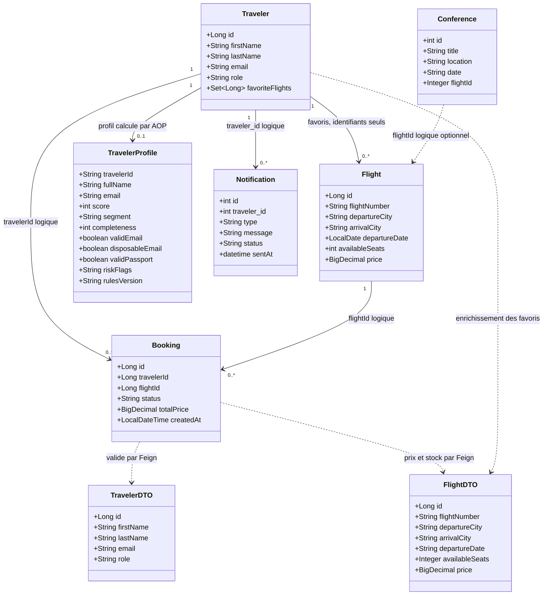
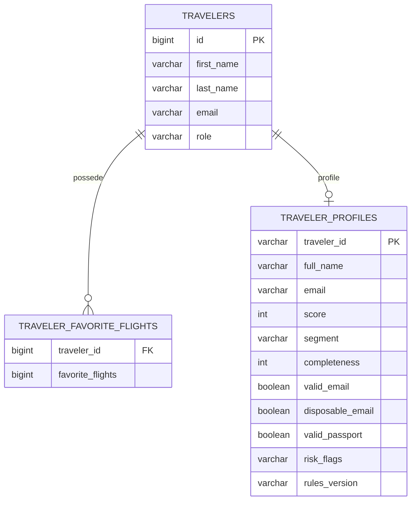
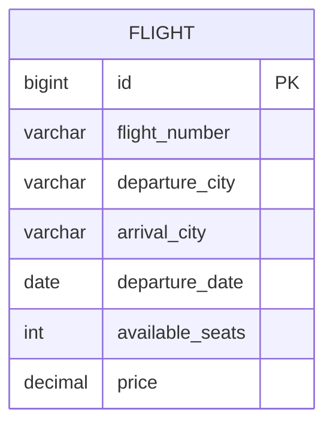
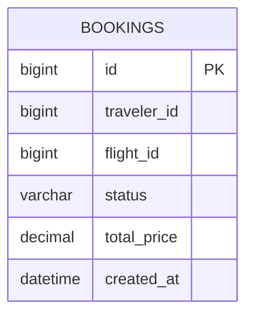

# 03 - Modele de domaine

Trois entites JPA persistent, trois objets « polyglottes » vivent en memoire et deux DTO
transportent les donnees entre services. Regle structurante : **aucune cle etrangere ne
traverse une frontiere de service**.

## 1. Diagramme de classes



Deux variantes de `FlightDTO` coexistent, volontairement :

| Variante | Champs | Utilisee par |
|---|---|---|
| `traveler/dto/FlightDTO` | id, flightNumber, departureCity, arrivalCity, departureDate, availableSeats, price | favoris |
| `booking/dto/FlightDTO` | id, `origin` mappe sur `departureCity`, `destination` mappe sur `arrivalCity`, availableSeats, price | saga |

Le mapping par `@JsonProperty` cote Booking montre qu'un DTO est un **contrat local** :
chaque service ne decode que ce dont il a besoin.

## 2. Bases de donnees

`spring.jpa.hibernate.ddl-auto=update` : les tables sont creees au premier demarrage.
Les trois bases sont independantes ; on ne peut pas joindre `bookings` et `flight`.

### 2.1 `nomadix_traveler_db`



La table de collection est generee par Hibernate (`@ElementCollection`, nom implicite).
`TRAVELER_PROFILES.traveler_id` est une chaine : le profil survit a un changement de type
d'identifiant metier.

### 2.2 `nomadix_flight_db`



### 2.3 `nomadix_booking_db`



`traveler_id` et `flight_id` ne sont pas des cles etrangeres : ce sont des references
logiques vers d'autres bases. C'est le prix (assume) du database-per-service, et la raison
pour laquelle les validations passent par Feign.

## 3. Regles metier du stock de places

`FlightRepository` ne fait jamais « lire puis ecrire » :

```sql
UPDATE flight
SET available_seats = available_seats - 1
WHERE id = :id AND available_seats > 0
```

- 1 ligne modifiee = place obtenue ;
- 0 ligne = vol complet ou inexistant, traduit en `409` (apres verification d'existence
  pour distinguer `404`).

`release` fait `+1` sans condition : la garde d'idempotence est cote Booking, qui ne rend
la place que si la reservation n'etait pas deja annulee.

## 4. Moteur de profilage (service avance)

### 4.1 Bareme (`ProfilingRulesEngine`, version 1.1)

| Regle | Points | Detail |
|---|---:|---|
| Completude | 40 | 6 champs attendus, au prorata |
| E-mail valide | 10 | regex RFC simplifiee |
| E-mail non jetable | 5 | domaine hors liste noire |
| Passeport valide | 15 | 6 a 9 caracteres alphanumeriques |
| Telephone valide | 10 | 8 a 15 chiffres, `+` et espaces acceptes |
| Qualite du nom | 5 | longueur >= 3 et espace (sinon 2) |
| Nationalite renseignee | 5 | - |
| Coherence | 10 | e-mail **et** passeport valides |
| **Total** | **100** | score borne entre 0 et 100 |

Segments : `PLATINUM >= 80`, `GOLD >= 65`, `SILVER >= 45`, `BRONZE < 45`.
Sous 45, le flag `PROFIL_A_RISQUE` est ajoute.
Domaines jetables detectes : `mailinator.com`, `tempmail.com`, `10minutemail.com`,
`yopmail.com`, `guerrillamail.com`, `trashmail.com`, `sharklasers.com`, `getnada.com`.

### 4.2 Application a l'entite Traveler actuelle

L'entite `Traveler` ne porte que `firstName`, `lastName`, `email`, `role`. Le moteur
attend aussi telephone, passeport, nationalite et date de naissance. Consequence :

| Element | Valeur pour un voyageur complet |
|---|---|
| Completude | 2 champs sur 6 = 13 points |
| E-mail valide et non jetable | 15 points |
| Qualite du nom | 5 points |
| Passeport, telephone, nationalite, coherence | 0 point, flags de manque |
| **Score plafond reel** | **33 / 100, segment BRONZE** |

Un profil genere automatiquement est donc toujours `BRONZE` avec `PROFIL_A_RISQUE` et des
flags `PASSEPORT_MANQUANT` / `EMAIL_MANQUANT`. C'est un ecart entre le modele de donnees et
le service avance, pas un bug de calcul : pour obtenir des segments superieurs, ajouter les
champs optionnels au voyageur, ou alimenter le profil par un DTO dedie.

### 4.3 Endpoints de lecture

| Endpoint | Reponse |
|---|---|
| `GET /api/travelers/profiles` | tous les profils |
| `GET /api/travelers/profiles/top?limit=5` | classement par score decroissant |
| `GET /api/travelers/profiles/segments` | effectif par segment |
| `GET /api/travelers/profiles/statistics` | KPIs agreges et version des regles |
| `GET /api/travelers/profiles/risky` | profils sous 45 |
| `GET /api/travelers/profiles/{travelerId}` | profil individuel, 404 sinon |
| `POST /api/travelers/profiles/{travelerId}/recompute` | recalcul avec les regles courantes |

Tous sont reserves a `ADMIN`, a la Gateway comme dans le service.
