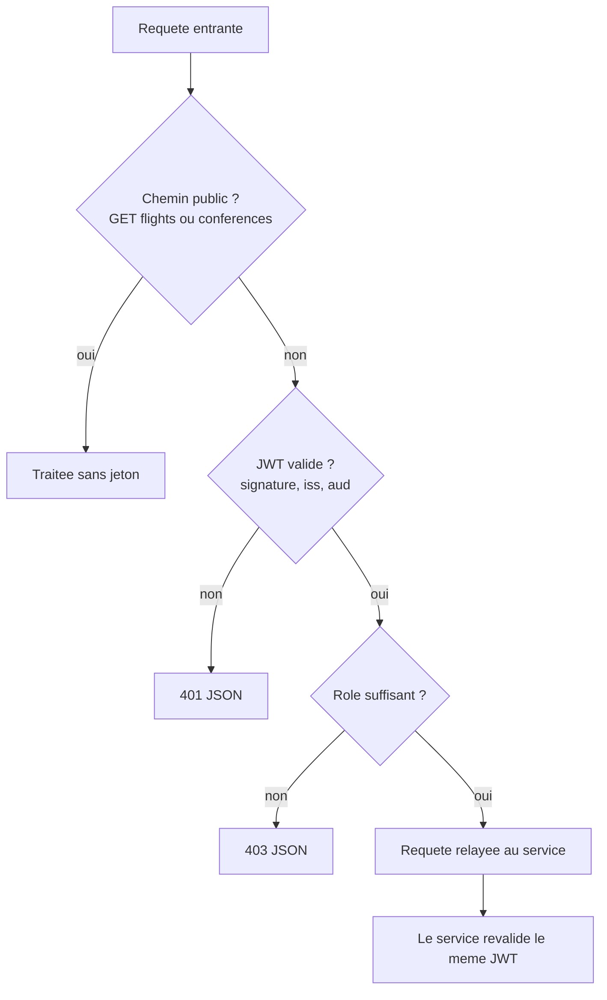
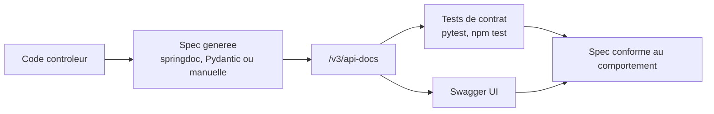

# 04 - Reference API

Catalogue des routes reellement servies, droits appliques et codes de retour. Les URLs
Swagger et la procedure de verification sont en fin de document.

## 1. Ou se trouve chaque specification

| Service | Swagger UI | Spec JSON | Source de verite |
|---|---|---|---|
| Traveler 8081 | `http://localhost:8081/swagger-ui.html` | `/v3/api-docs` | annotations + `config/OpenApiConfig` |
| Flight 8082 | `http://localhost:8082/swagger-ui.html` | `/v3/api-docs` | annotations + `config/OpenApiConfig` |
| Booking 8083 | `http://localhost:8083/swagger-ui.html` | `/v3/api-docs` | annotations + `config/OpenApiConfig` |
| Notification 8084 | `http://localhost:8084/swagger-ui` | `/v3/api-docs` | Pydantic + FastAPI |
| Conference 3000 | `http://localhost:3000/swagger-ui` | `/v3/api-docs` | spec OpenAPI 3.0.3 ecrite a la main |

La Gateway (8089) **n'expose pas** de Swagger : elle ne route pas `/v3/api-docs`.

En **Docker Compose**, les ports publies sont decales de +1000 : Swagger UI est sur
`http://localhost:9081/swagger-ui.html` (traveler), `9082`, `9083`, `9084` et
`http://localhost:3001/swagger-ui` (conference). Le champ `servers` de chaque spec place
**d'abord** `http://localhost:9089` (la Gateway publiee) : c'est le serveur selectionne
par defaut, donc "Try it out" tape une adresse qui existe reellement. Les ports de dev
(8081-8089) restent listes ensuite pour un lancement hors Docker.

Le CORS de la Gateway accepte tous les ports de `localhost` et `127.0.0.1`
(`allowedOriginPatterns`), ce qui couvre le frontend (4200 dev, 8090 Docker) et toutes les
UI Swagger sans avoir a maintenir une liste d'origines figee.

## 2. Regle d'autorisation



## 3. Traveler-Service (8081)

| Methode | Chemin | Gateway | Direct 8081 | Succes | Erreurs |
|---|---|---|---|---|---|
| GET | `/api/travelers` | authentifie | authentifie | 200 | 401 |
| GET | `/api/travelers/{id}` | authentifie | authentifie | 200 | 401, 404 |
| POST | `/api/travelers` | authentifie | authentifie | 201 | 401 |
| PUT | `/api/travelers/{id}` | authentifie | authentifie | 200 | 401, 404 |
| DELETE | `/api/travelers/{id}` | ADMIN | ADMIN | 204 | 401, 403, 404 |
| GET | `/api/travelers/{id}/favorite-flights` | authentifie | authentifie | 200 | 401, 404 |
| POST | `/api/travelers/{id}/favorite-flights/{flightId}` | authentifie | authentifie | 200 | 401, 404, 503 |
| DELETE | `/api/travelers/{id}/favorite-flights/{flightId}` | authentifie | authentifie | 200 | 401, 404 |
| GET | `/api/travelers/profiles/**` | ADMIN | ADMIN | 200 | 401, 403 |
| POST | `/api/travelers/profiles/{id}/recompute` | ADMIN | ADMIN | 200 | 401, 403, 404 |
| POST | `/api/packh/traveler-events/emit` | **non route** | ADMIN | 200 | 401, 403 |

## 4. Flight-Service (8082)

| Methode | Chemin | Gateway | Direct 8082 | Succes | Erreurs |
|---|---|---|---|---|---|
| GET | `/api/flights` | public | public | 200 | - |
| GET | `/api/flights/{id}` | public | public | 200 | 404 |
| POST | `/api/flights` | ADMIN | ADMIN | 200 | 401, 403 |
| PUT | `/api/flights/{id}` | ADMIN | ADMIN | 200 | 401, 403, 404 |
| DELETE | `/api/flights/{id}` | ADMIN | ADMIN | 204 | 401, 403, 404 |
| POST | `/api/flights/{id}/seats/reserve` | ADMIN | authentifie | 200 | 401, 404, 409 |
| POST | `/api/flights/{id}/seats/release` | ADMIN | authentifie | 200 | 401, 404 |
| POST | `/api/packh/flight-events/emit` | **non route** | ADMIN | 200 | 401, 403 |

`seats/reserve` et `seats/release` sont des routes **internes** : le Booking-Service les
appelle en direct avec le jeton du voyageur, ce que la regle Gateway `POST /api/flights/**`
= ADMIN interdit a un navigateur. Ce n'est pas un oubli : cela empeche un client de
consommer du stock sans passer par la saga.

## 5. Booking-Service (8083)

| Methode | Chemin | Gateway | Direct 8083 | Succes | Erreurs |
|---|---|---|---|---|---|
| POST | `/api/bookings?travelerId=X&flightId=Y` | authentifie | authentifie | 201 | 400, 401, 404, 409, 503 |
| GET | `/api/bookings` | authentifie | authentifie | 200 | 401 |
| GET | `/api/bookings/{id}` | authentifie | authentifie | 200 | 401, 404 |
| PUT | `/api/bookings/{id}?status=S` | authentifie | authentifie | 200 | 400, 401, 404, 409, 503 |
| DELETE | `/api/bookings/{id}` | authentifie | authentifie | 204 | 401, 404 |

`400` : statut hors `PENDING` / `CONFIRMED` / `CANCELLED`.
`409` : vol complet, a la creation comme a la reactivation.
`503` : Traveler ou Flight indisponible, ou circuit breaker ouvert.

## 6. Notification-Service (8084)

| Methode | Chemin | Gateway | Direct 8084 | Succes | Erreurs |
|---|---|---|---|---|---|
| GET | `/health` | non route | public | 200 | - |
| GET | `/` | non route | public | 200 | - |
| GET | `/api/notifications/hello` | authentifie | public | 200 | - |
| GET | `/api/notifications` | authentifie | public | 200 | - |
| GET | `/api/notifications/events` | authentifie | public | 200 | - |
| POST | `/api/notifications` | authentifie | public | 201 | 422 |
| GET | `/api/notifications/{id}` | authentifie | public | 200 | 404 |
| PUT | `/api/notifications/{id}` | authentifie | public | 200 | 404, 422 |
| DELETE | `/api/notifications/{id}` | authentifie | public | 204 | 404 |

Corps attendu (contrat Pydantic, source unique de la spec) :

```json
{
  "traveler_id": 1,
  "type": "booking_confirmed",
  "message": "Votre vol TN-404 vers Paris a ete confirme"
}
```

`type` accepte `flight_delay`, `booking_confirmed`, `payment_success`. La reponse ajoute
`id`, `status` et `sentAt`.

## 7. Conference-Service (3000)

| Methode | Chemin | Gateway | Direct 3000 | Succes | Erreurs |
|---|---|---|---|---|---|
| GET | `/` | non route | public | 200 | - |
| GET | `/api/conferences` | public | public | 200 | - |
| GET | `/api/conferences/{id}` | public | public | 200 | 404 |
| POST | `/api/conferences` | ADMIN | public | 201 | 400 |
| PUT | `/api/conferences/{id}` | ADMIN | public | 200 | 400, 404 |
| DELETE | `/api/conferences/{id}` | ADMIN | public | 204 | 404 |
| GET | `/api/meetings/hello` | non route | public | 200 | - |

`400` : `title`, `location` ou `date` manquant. Le service Node ne valide pas le JWT :
directement sur 3000, une ecriture passe sans jeton.

## 8. Contrat de codes de retour

| Code | Signification dans Nomadix |
|---|---|
| 200 | lecture ou mise a jour reussie |
| 201 | creation (voyageur, reservation, notification, conference) |
| 204 | suppression reussie, sans corps |
| 400 | parametre ou corps metier invalide |
| 401 | jeton absent, expire, mauvaise audience ou mauvais emetteur |
| 403 | jeton valide mais role insuffisant |
| 404 | ressource inexistante, y compris en cascade via Feign |
| 409 | conflit metier : vol complet |
| 422 | corps refuse par la validation Pydantic |
| 503 | dependance indisponible ou circuit breaker ouvert |

## 9. Verifier une specification en 30 secondes

```bash
# 1) la spec est-elle servie et contient-elle les routes attendues ?
curl -s http://localhost:8082/v3/api-docs | jq -r '.paths | keys[]'
curl -s http://localhost:3000/v3/api-docs | jq -r '.paths | keys[]'

# 2) un jeton de test (client nomadix-cli, password grant)
TOKEN=$(curl -s -X POST http://localhost:8180/realms/nomadix/protocol/openid-connect/token \
  -d grant_type=password -d client_id=nomadix-cli \
  -d username=admin -d password=admin123 | jq -r .access_token)

# 3) appeler la Gateway comme le frontend
curl -s -H "Authorization: Bearer $TOKEN" http://localhost:8089/api/bookings
```



## 10. Ce qui a ete verifie automatiquement

| Verification | Commande | Resultat |
|---|---|---|
| Spec Conference : chemins et `$ref` | script Node sur `src/config/swagger` | 3 chemins, aucune reference cassee |
| Comportement Conference | appels HTTP reels sur l'app Express | 200 / 201 / 400 / 404 / 204 conformes |
| Contrat Notification | `venv/Scripts/python.exe -m pytest -q` | 8 tests passes |
| Contrat Conference | `npm test` | 7 tests passes |
| Compilation des annotations Swagger | `mvn -o -DskipTests compile` (3 services) | succes |
| CORS Gateway | preflight `OPTIONS` depuis 9081 / 8090 / 4200 / 3001 | 200 + `Access-Control-Allow-Origin` |
| Autorisation Gateway | `POST /api/flights` avec token TRAVELER puis ADMIN | 403 puis 200 |
| RabbitMQ (6 scenarios) | emission, consommation, arret du consommateur, DLX/DLQ | `Ready` 0 -> 3 -> 0, DLQ + `x-death` |
| OpenFeign | `GET /api/bookings/integrations/feign` | `reachable=true` sur les deux services |

Les scenarios detailles (commandes exactes et lecture de la console RabbitMQ) sont dans le
Swagger du Booking-Service, section `1. Scenarios RabbitMQ` et `2. Scenarios OpenFeign`.
